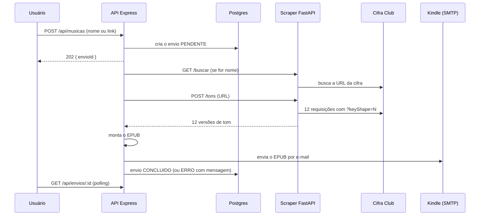

# Adaptador de Cifras para Kindle

> Busca uma cifra no Cifra Club, transpõe para os 12 tons e envia um único EPUB navegável para o Kindle por e-mail (Send-to-Kindle).

**EN:** Personal tool that fetches a song's chord sheet from Cifra Club, collects it in all 12 chromatic
keys and bundles them into a single EPUB with internal links (so you change key by tapping a link on the
Kindle, with no extra download). The file is emailed to the Kindle through SMTP. Node.js/Express + Postgres
API, Python/FastAPI scraper and a Next.js front-end.

## Sobre

Projeto pessoal e solo, feito para ler cifras no Kindle e trocar de tom na hora, sem sair do livro. O EPUB
abre no tom original da música e traz um seletor com os 12 tons; cada tom é uma página, ligada às outras por
links internos.

> **Uso pessoal e sem fins comerciais.** Este projeto não é afiliado ao Cifra Club nem à Amazon. Ele busca,
> no momento do uso, cifras que você mesmo pediu, para leitura pessoal no seu Kindle. Não armazena catálogo,
> não redistribui conteúdo e as fixtures de teste têm a letra truncada. Quem usar é responsável por respeitar
> os Termos de Uso do Cifra Club e os direitos autorais das músicas.

## Funcionalidades

- **Busca por nome ou por link:** o nome é resolvido para a URL canônica da cifra no Cifra Club; um link
  colado é usado direto (só `https` e domínio `cifraclub.com.br`).
- **12 tons:** os 12 tons cromáticos (C, C#, D, … B; só sustenidos, tom menor mantém o `m`). A transposição
  é feita pelo próprio Cifra Club (`?keyShape=N`), sem transposição musical local.
- **Capotraste:** o tom exibido é o que soa; os acordes impressos são a forma. O EPUB avisa
  "Capotraste na Nª casa — os acordes abaixo estão na forma, não no tom que soa".
- **EPUB único:** reflowable, com sumário e seletor de tom em cada página, fonte monooespaçada para manter
  o alinhamento acorde/letra. Validado com o EPUBCheck oficial do W3C.
- **Envio para o Kindle:** e-mail com o EPUB anexado por SMTP (Gmail com senha de app). Acompanhamento do
  progresso por `GET /api/envios/:id`.
- **Erros claros:** cifra inexistente, música só com letra (medley) e Cifra Club fora do ar viram mensagens
  legíveis, nunca uma lista parcial de tons.

## Tecnologias

- **Back-end:** Node.js 22+, TypeScript, Express 5, Knex, Zod, jszip (EPUB), nodemailer (SMTP)
- **Banco de dados:** PostgreSQL (Docker Compose, porta 5433)
- **Scraper:** Python 3.12, FastAPI, `curl_cffi` (fingerprint TLS do Chrome), BeautifulSoup/lxml
- **Front-end:** Next.js 16 (App Router), React 19 e TypeScript em `apps/web`, CSS próprio, sem biblioteca de UI
- **Testes:** Vitest (Node) e pytest (scraper)
- **Validação do EPUB:** EPUBCheck 5.4.0 (W3C)

## Arquitetura

O back-end segue camadas: **rotas → controllers → services → repositories/integrations**. Os schemas do Zod
validam a entrada. O scraper é um serviço separado, consumido pela camada `integrations`.

```
server.ts              # sobe o Express (e confere se as migrations já rodaram)
app.ts                 # Express, rotas e tratamento de erro
routes/                # /api/musicas e /api/envios
controllers/           # traduz HTTP para chamadas de service
services/              # pipeline: busca → 12 tons → EPUB → envio
repositories/          # SQL de musicas e envios (Knex)
integrations/          # clientes do scraper e do SMTP
schemas/               # validação com Zod
migrations/            # Knex
scripts/               # migrate e epubcheck
scraper/               # FastAPI: /buscar e /tons no Cifra Club
apps/web/              # front-end Next.js (formulário e acompanhamento do envio)
tests/                 # Vitest
```

Fluxo de um envio:



## Como rodar

### Pré-requisitos

- Node.js 22 ou mais recente
- Docker (para o Postgres)
- Python 3.12 (para o scraper; no Windows, veja a seção Solução de problemas)
- Para o envio real: conta Gmail com senha de app e o e-mail do Kindle (Approved Sender)

### Variáveis de ambiente

Copie `.env.example` para `.env` e ajuste:

```sh
cp .env.example .env
```

| Variável | Para que serve | Exemplo |
| --- | --- | --- |
| `NODE_ENV` | Ambiente | `development` |
| `PORT` | Porta da API | `3333` |
| `DATABASE_URL` | Conexão com o Postgres | veja `.env.example` |
| `DATABASE_URL_TEST` | Banco usado nos testes | veja `.env.example` |
| `SCRAPER_BASE_URL` | Endereço do scraper | `http://localhost:8000` |
| `SMTP_HOST` / `SMTP_PORT` | Servidor SMTP | `smtp.gmail.com` / `587` |
| `SMTP_USER` / `SMTP_PASS` | Conta remetente e senha de app | sua conta Gmail e a senha de app |
| `KINDLE_EMAIL_TO` | E-mail do seu Kindle | `seu-nome@kindle.com` |

O remetente (`SMTP_USER`) precisa estar na lista de **e-mails aprovados** da sua conta Amazon. O `.env`
nunca é versionado.

### Banco de dados

```sh
npm run services:up   # sobe só o Postgres
npm install
npm run migrate
```

### Back-end e front-end

```sh
npm run dev                          # API em http://localhost:3333
npm --prefix apps/web install
npm --prefix apps/web run dev        # front em http://localhost:3010
```

### Scraper

```sh
cd scraper
pip install -r requirements.txt
uvicorn main:app --reload --host 0.0.0.0 --port 8000
```

### Tudo em Docker (alternativa)

Com o `.env` criado, sobe os 4 serviços com autoreload:

```sh
npm run docker:dev
```

Front em `http://localhost:3010`, API em `http://localhost:3333/api/health`, scraper em
`http://localhost:8000/`.

## Uso pela interface

Com a API (`:3333`) e o front (`:3010`) no ar, abra `http://localhost:3010`, digite o nome da música ou cole
um link do Cifra Club e clique em **Enviar ao Kindle**. A tela mostra o progresso do envio
(na fila, buscando, transpondo, montando o EPUB, enviando) e a mensagem de erro quando algo falha. O front
chama `/api/*` na mesma origem e o Next repassa para a API (`API_PROXY_TARGET`, padrão
`http://localhost:3333`).

## Uso da API

Envia uma música pelo nome ou por um link do Cifra Club (exatamente um dos dois):

```sh
curl -X POST http://localhost:3333/api/musicas \
  -H "Content-Type: application/json" \
  -d '{"nome":"the scientist coldplay"}'
# 202 {"envioId":"<uuid>"}

curl http://localhost:3333/api/envios/<uuid>
```

O envio passa pelos status `pendente → buscando → transpondo → gerando → enviando → concluido`, ou termina em `erro` com a mensagem do motivo.

## Solução de problemas

### Scraper fora do Docker: versão do Python

A imagem do scraper usa `python:3.12-slim` (ver `scraper/Dockerfile.dev`), então use Python 3.12 no venv
local.

Python 3.15 ainda não funciona: `uvicorn[standard]` puxa `pyyaml`, que não compila nessa versão, e
`pip install -r requirements.txt` falha. O Docker não é afetado, porque usa a própria imagem Python.

1. Crie o venv a partir da raiz do projeto (com Python 3.12 instalado no Windows):

   ```powershell
   py -3.12 -m venv scraper/.venv
   ```

2. Ative o venv:

   ```powershell
   scraper\.venv\Scripts\Activate.ps1
   ```

   No cmd, use `scraper\.venv\Scripts\activate.bat`. Se o PowerShell bloquear o script, rode uma vez
   `Set-ExecutionPolicy -Scope CurrentUser RemoteSigned`.

3. Instale as dependências e suba o scraper:

   ```powershell
   cd scraper
   pip install -r requirements.txt
   uvicorn main:app --port 8000
   ```

**Contorno** se o `pip install -r requirements.txt` continuar falhando: instale as dependências sem o
extra `[standard]` do uvicorn:

```powershell
pip install fastapi uvicorn "pydantic>=2" requests curl_cffi beautifulsoup4 lxml
```

Sem `uvicorn[standard]`, o `--reload` usa o StatReload, que detecta mudanças mais devagar.

### Scripts do BMAD com `uv`

Os scripts do BMAD em `.claude/skills/*/scripts` rodam com `uv run`. Se o `uv` não estiver instalado, instale
no PowerShell:

```powershell
powershell -c "irm https://astral.sh/uv/install.ps1 | iex"
```

Documentação: https://docs.astral.sh/uv/

## Testes

```sh
npm run typecheck   # tsc --noEmit
npm test            # Vitest (back-end)
cd scraper && pytest
```

O boot da API contra um Postgres sem migrations falha alto (nunca migra sozinho), veja
`database/migrationGuard.ts`.

### Validar o EPUB (EPUBCheck)

`npm run epubcheck` gera EPUBs sintéticos (sem capo, capo + tom menor com sustenido, linhas de 60 e 80
colunas) e os valida com o EPUBCheck oficial do W3C. Falha com erro ou aviso inesperado; o aviso `NAV-011`
(sumário em ordem cromática, spine abrindo no tom original) é aceito de propósito.

Precisa de Java e do jar, que fica em `tools/` (ignorado pelo git):

```bash
gh release download v5.4.0 --repo w3c/epubcheck --pattern "epubcheck-5.4.0.zip" --dir tools/epubcheck
cd tools/epubcheck && unzip epubcheck-5.4.0.zip
```

O EPUBCheck só valida a **estrutura**. Para ver como cada aparelho renderiza (largura de tela, corte de
linha larga, fonte), abra os arquivos de `tools/epubcheck/amostras/` no
[Kindle Previewer](https://www.amazon.com/Kindle-Previewer/b?node=21381691011) e escolha vários perfis de
dispositivo. Cifras reais têm a linha mais larga entre ~33 e ~60 colunas.

## Limitações conhecidas

- O rótulo de tom do Cifra Club às vezes discorda dos acordes impressos (ex.: Yellow, rótulo E, acordes em
  B). O projeto confia no rótulo.
- Medleys sem cifra (o Cifra Club redireciona para `/letra/`) falham com mensagem clara.
- Testado só em um Kindle básico de última geração. Outros modelos dependem de abrir os EPUBs de amostra no
  Kindle Previewer.

## O que aprendi

<!-- TODO: pedir ao Thiago de 3 a 5 aprendizados técnicos deste projeto -->

## Licença

Distribuído sob a licença MIT. Veja o arquivo [LICENSE](LICENSE).

## Autor

Thiago Enrico Costa Cardoso — [LinkedIn](https://www.linkedin.com/in/thiago-enrico-costa-cardoso/) · [Portfólio](https://teccdev.com.br/)
