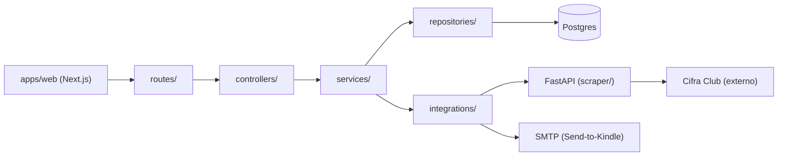
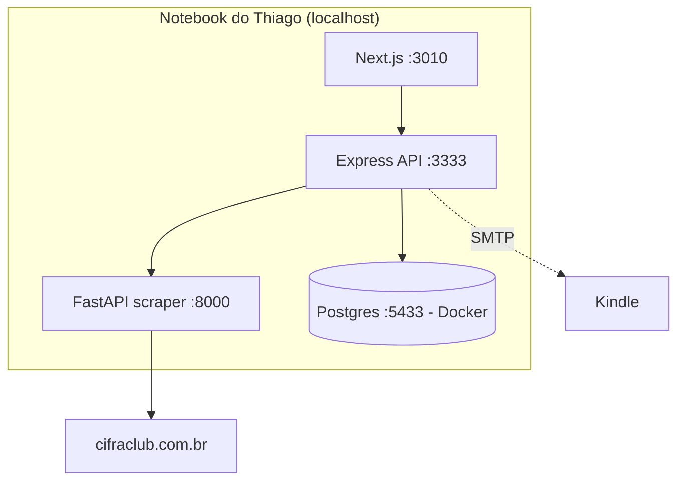
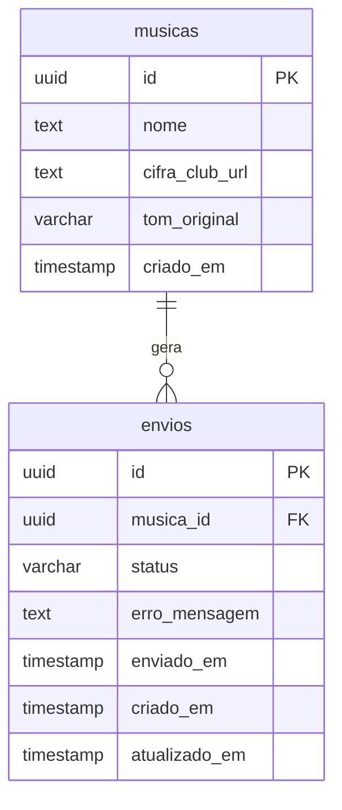

# Architecture Spine — Adaptador de Cifras para Kindle

## Design Paradigm

Pipeline em camadas: cada estagio do fluxo busca → transpoe → gera → envia mora numa camada/servico distinto (pipes-and-filters), dentro de uma organizacao MVC-like ratificada da convencao pessoal do autor (projetos pessoais anteriores: projetos pessoais anteriores):

- `routes/` → `controllers/` — entrada HTTP, sem logica de negocio.
- `services/` — orquestracao do pipeline (chama `repositories/` e `integrations/`).
- `repositories/` — unico ponto de acesso ao Postgres (via Knex).
- `integrations/` — fronteiras externas ao processo Node (FastAPI de scraping, SMTP de envio).
- `apps/web` (Next.js) — consome a API Express; nao contem logica de negocio.

## Invariants & Rules



### AD-1 — Fronteira Python/Node via HTTP

- **Binds:** FR-1, FR-2
- **Rule:** o scraping do Cifra Club roda como servico FastAPI proprio (`scraper/`); `integrations/` no Node consome exclusivamente via HTTP, nunca `child_process` nem import cross-linguagem. FastAPI expoe duas operacoes: busca por nome (`GET /buscar?nome=`, resolve para uma `cifra_club_url`) e obtencao das 12 versoes de tom (`POST /tons`, recebe `{ cifra_club_url }`, retorna `{ versions: [{ tom, semitone_offset, is_original, conteudo }] }` com exatamente 12 itens, um deles com `is_original: true`). Erros seguem a convencao do projeto (`{ error: string }`, ver Consistency Conventions), com HTTP 404 para musica nao encontrada e 502 para falha de scraping.
- **Prevents:** Node e Python divergirem sobre como sao invocados, quem resolve nome→url, e qual o formato da resposta/erro entre os dois servicos.

### AD-2 — Transposicao delegada a URL do Cifra Club

- **Binds:** FR-2
- **Rule:** cada uma das 12 versoes de tom e obtida requisitando a URL do Cifra Club com o parametro de tom correspondente. Nenhuma logica de transposicao de acordes e implementada localmente no MVP. Os 12 tons sao sempre nomeados e ordenados com sustenidos (C, C#, D, D#, E, F, F#, G, G#, A, A#, B), nunca bemois, independente de como o Cifra Club exibe o tom na pagina de origem. O tom original e o que a URL sem parametro de tom retorna; FastAPI marca esse item com `is_original: true` — nenhuma outra heuristica (ex: "primeiro da lista") decide isso.
- **Prevents:** reimplementar um motor de transposicao proprio, e Node/FastAPI/EPUB divergirem sobre qual tom e "o original" ou como cada tom e grafado.

### AD-3 — Um EPUB multi-tom por musica, navegavel

- **Binds:** FR-3
- **Rule:** FR-3 produz exatamente um arquivo EPUB reflowable por musica buscada, com as 12 versoes de tom como secoes ligadas por links internos (TOC/ancoras), abrindo na secao do tom original. PDF esta excluido (nao suporta navegacao interna). O CSS do EPUB forca fonte monoespacada (`white-space: pre` ou equivalente) em todo bloco de cifra, para nao quebrar o alinhamento acorde-sobre-silaba ao refluir (risco identificado no addendum do brief). Ancoras internas usam o nome do tom em sustenido (ver AD-2) como id (ex: `#tom-C`, `#tom-Csharp`) — unico esquema de nomenclatura aceito. Tablaturas permanecem fora de escopo (ver PRD FR-3 Out of Scope): nenhuma secao de tablatura e gerada.
- **Prevents:** gerar 12 arquivos separados, escolher um formato que quebra a navegacao, ou quebrar o alinhamento de colunas ao refluir o EPUB.

### AD-4 — Troca de tom ao vivo e navegacao local, nunca reenvio

- **Binds:** FR-4
- **Rule:** `services/` so aciona o pipeline completo (busca→transpoe→gera→envia) para uma musica nova. Nenhum endpoint ou fluxo trata "trocar de tom" como gatilho de rede. NFR de tempo (PRD OQ-4, reenquadrada): o ciclo completo deve rodar confortavelmente antes do evento (ensaio/culto/show) — sem meta numerica travada, pois nao ha pressao de latencia ao vivo sobre ele.
- **Prevents:** qualquer parte do sistema assumir que uma troca de tom ao vivo exige nova chamada ao backend.

### AD-5 — Fluxo de dependencia unidirecional no backend [ADOPTED]

- **Binds:** all (Express/TS)
- **Rule:** `routes → controllers → services → repositories → database`; so `services/` chama `integrations/`. `controllers/` nunca acessam `repositories/` ou `integrations/` diretamente.
- **Prevents:** logica de orquestracao se infiltrar em controllers/repositories, ou acesso ao banco pulando a camada de repository.

### AD-6 — Validacao de entrada via Zod [ADOPTED]

- **Binds:** all (endpoints HTTP)
- **Rule:** todo corpo de requisicao HTTP e validado por um schema Zod em `schemas/` antes de chegar ao controller.
- **Prevents:** validacao ad-hoc e inconsistente entre endpoints.

### AD-7 — Modelo de dados em duas tabelas

- **Binds:** FR-1, FR-4 (historico/progresso)
- **Rule:** `musicas` e `envios` sao tabelas Postgres separadas (ver Structural Seed), relacionadas por `musica_id`. `status` de envio e `varchar` validado por um enum Zod fixo na camada de aplicacao (nao enum nativo do Postgres): `pendente | buscando | transpondo | gerando | enviando | concluido | erro` — nenhum outro valor e valido, e nenhuma camada inventa vocabulario proprio de progresso.
- **Prevents:** dado de musica e dado de envio ficarem acoplados numa unica linha (travando a evolucao para repertorio/Fase 2), e builders divergentes usando vocabularios de status diferentes.

### AD-8 — Sem retencao de conteudo da cifra

- **Binds:** `musicas`, `envios` (modelo de dados)
- **Rule:** `musicas` e `envios` armazenam apenas metadados (nome, url, tom original, status, timestamps) — nunca a letra/cifra completa. O conteudo transita em memoria durante o pipeline e so existe persistido dentro do EPUB final entregue ao Kindle.
- **Prevents:** uma futura feature (ex: cache de cifras, ver Deferred) persistir conteudo protegido por direitos autorais no banco, ampliando o risco alem do uso pessoal ja aceito (PRD §5).

## Consistency Conventions

| Concern | Convention |
| --- | --- |
| Naming (entidades, arquivos, interfaces) | camelCase para arquivos/variaveis TS; PascalCase para interfaces/tipos; tabelas em snake_case plural (`musicas`, `envios`) |
| Data & formats | ids `uuid`; timestamps `timestamptz`; status de envio como string validada (nao enum nativo); erros HTTP como `{ error: string }` |
| State & cross-cutting | sem autenticacao/multiusuario no MVP (non-goal do PRD); config via `.env` compartilhado entre os servicos Node + `config/env.ts` tipado; logging via `console.log`/`console.error` diretos, sem lib dedicada e sem agregacao estruturada no MVP |

## Stack

| Name | Version |
| --- | --- |
| Node.js | >=22 (bumped do floor >=20 dos projetos anteriores — Node 20 ja fora de LTS) |
| TypeScript | ^7.0.2 |
| Express | ^5.x (decisao consciente: diverge do Express 4 dos projetos anteriores do autor, por Express 4 estar em modo de manutencao/EOL — ver memlog) |
| Knex | ^3.1.0 (Drizzle/Kysely considerados e descartados — ver Deferred) |
| pg (node-postgres) | ^8.23.1 |
| Zod | ^4.6.7 |
| Vitest | ^3.2.7 |
| Next.js | ^16.4.3 |
| React / React DOM | ^19.3.1 |
| PostgreSQL | 17 (imagem `postgres:17-alpine`) |
| Python | >=3.12 |
| FastAPI | 0.163.0 (verificado via web em 2026-11-17) |
| Pydantic | ^2.x (exigido pelo FastAPI 0.163+) |
| Uvicorn | ultima estavel compativel com FastAPI 0.163 — nao verificada individualmente, confirmar no `pip install` |

_Linhas com evidencia direta (projetos pessoais do autor, ou verificacao web datada) estao mais confiantes; as demais usam o major mais recente plausivel e devem ser reconfirmadas no `npm install`/`pip install` — a Stack e seed, nao contrato: o codigo a assume uma vez que existir._

## Structural Seed



Ambiente de desenvolvimento local: os 4 servicos (Postgres, Express API, Next.js, FastAPI) sobem juntos via `docker-compose.dev.yml` (perfil `app`, seguindo a convencao dos projetos anteriores do autor), com um unico `.env`/`.env.example` na raiz compartilhado pelos servicos Node; o FastAPI le suas proprias variaveis via `.env` equivalente em `scraper/`.



```text
cifra-kindle/
  app.ts            # bootstrap Express (middlewares, rotas)
  server.ts         # entrypoint HTTP
  routes/           # dispatch HTTP -> controllers
  controllers/       # handlers HTTP, sem logica de negocio
  services/          # orquestracao do pipeline (busca->transpoe->gera->envia)
  repositories/       # unico acesso ao Postgres via Knex
  integrations/
    cifraClub/        # cliente HTTP para o FastAPI de scraping
    kindleMail/        # envio SMTP (Send-to-Kindle)
  schemas/            # validacao Zod dos corpos HTTP
  interfaces/          # tipos TS compartilhados
  database/            # conexao Knex/pg
  migrations/           # Knex migrations (musicas, envios)
  config/env.ts          # leitura tipada de variaveis de ambiente
  scripts/                # scripts avulsos (ex: reset de banco)
  tests/                   # Vitest
  apps/
    web/                    # Next.js - UI (buscar/colar link, historico, progresso)
  scraper/                   # servico FastAPI (Python) - scraping do Cifra Club
```

## Capability → Architecture Map

| Capability / Area | Lives in | Governed by |
| --- | --- | --- |
| FR-1 Buscar cifra por musica informada | `controllers/` + `services/` + `integrations/cifraClub` + `scraper/` | AD-1, AD-5 |
| FR-2 Transpor para todos os Tons | `scraper/` (FastAPI, parametro de URL do Cifra Club) | AD-2 |
| FR-3 Gerar Arquivo pronto (EPUB multi-tom) | `services/` | AD-3 |
| FR-4 Enviar automaticamente para o Kindle | `integrations/kindleMail` + `repositories/` (`envios`) | AD-4, AD-7 |
| Historico e progresso de envio (UI) | `apps/web` + `repositories/envios` via `GET /envios/:id` | AD-7 |

## Deferred

- **OQ-3 (termos de uso do Cifra Club):** checagem manual pendente, fora do controle da arquitetura; revisitar antes de qualquer uso alem do pessoal.
- **Approved Sender:** configuracao manual unica na conta Amazon do autor (PRD §5), pre-requisito de operacao fora do controle do software — nao e uma decisao de arquitetura.
- **Fase 2 (repertorio/coletaneas, navegacao entre musicas):** o modelo de dados (`musicas`) comporta a extensao, mas nenhuma logica de agregacao existe no MVP.
- **Abertura multiusuario / deploy na VPS:** direcao futura; exigiria introduzir autenticacao e multi-tenancy — nenhuma decisao tomada agora.
- **Observabilidade alem de `console.log`:** agregacao/correlacao de logs entre Node e FastAPI nao implementada no MVP (uso solo nao exige).
- **Cache de cifras ja buscadas:** nao implementado; cada envio refaz a busca completa dos 12 tons no Cifra Club.
- **ORM/query builder alternativo (Drizzle, Kysely):** considerados e descartados em favor de Knex, para manter consistencia com os projetos pessoais anteriores do autor.
