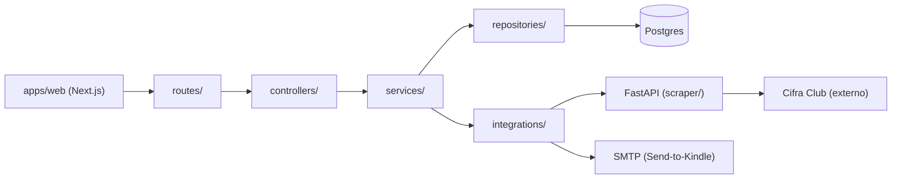
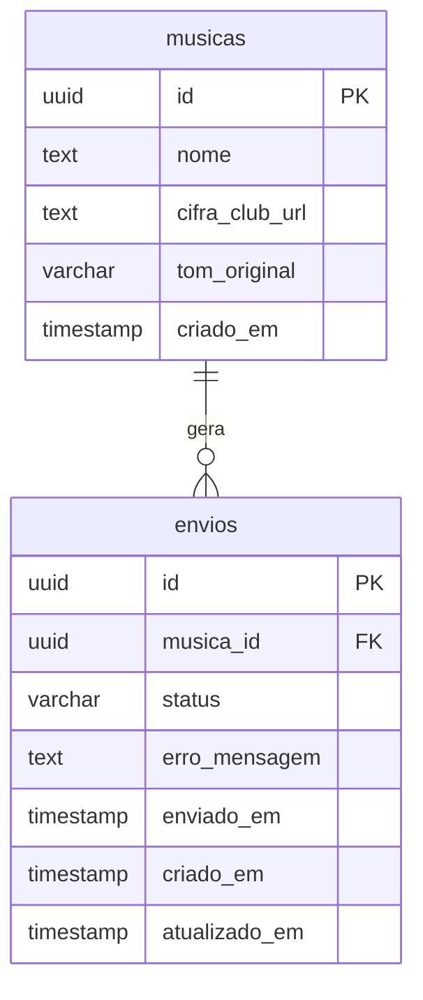

# Solution Design — Adaptador de Cifras para Kindle

> Este documento é o companheiro narrativo de `ARCHITECTURE-SPINE.md`. A spine é o contrato terso (o que *tem* que ser respeitado); este documento explica o raciocínio por trás de cada decisão e também serve como material de portfólio (curso de ADS). Onde a spine e este documento divergirem em algum detalhe técnico, a spine é a autoridade.
>
> Identificadores como `FR-N` (requisito funcional) e `OQ-N` (questão aberta) vêm do [PRD](../../prds/prd-cifra-kindle-2026-11-15/prd.md) e são citados ao longo do texto para rastreabilidade.

## 1. Contexto e Problema

Hoje, levar uma cifra para o Kindle é um processo manual: abrir o Cifra Club, copiar ou tirar print, ajustar o tom na mão, converter para um formato legível, enviar para o dispositivo — repetindo isso a cada música. O pior momento para sentir essa dor é durante um culto, ensaio ou apresentação, quando o tom de uma música muda de última hora e não há tempo para repetir esse processo manual.

O Adaptador de Cifras para Kindle é um projeto pessoal e solo (sem prazo, sem outros usuários) que automatiza essa cadeia inteira. O [PRD](../../prds/prd-cifra-kindle-2026-11-15/prd.md) descreve o *o quê* e o *por quê* em detalhe; este documento cobre o *como*.

## 2. A Ideia Central: Um Arquivo, Todos os Tons

A decisão mais importante deste projeto não é tecnológica — é de produto, e vale explicar por que ela mudou no meio do processo de arquitetura.

A primeira leitura do PRD sugeria "reenvio rápido": decidir o tom antes, e se o tom mudar ao vivo, reenviar rapidamente a cifra já no novo tom. Isso levou a uma pergunta de NFR sobre meta de latência de reenvio (OQ-4 do PRD original).

Só que, ao aprofundar a conversa sobre arquitetura, ficou claro que a ideia real é mais simples e mais robusta: **gerar, de antemão, um único EPUB (o "Arquivo pronto" do PRD) contendo a Cifra nos 12 tons cromáticos possíveis, navegável por links internos**, abrindo no Tom original. Ao vivo, trocar de tom não é mais "reenviar algo" — é **tocar num link dentro do próprio arquivo já carregado no Kindle**. Latência zero, sem depender do notebook, sem rede.

Isso resolve três coisas de uma vez:
- Elimina a pressão de latência ao vivo (não existe mais "reenvio sob pressão de tempo").
- Resolve a escolha de formato do arquivo (OQ-1): tem que ser **EPUB reflowable**, porque PDF não suporta links internos.
- Resolve o mecanismo de transposição (OQ-2) — ver §4.1.

A ideia de "bundlar múltiplos tons num arquivo só" já tinha aparecido na pesquisa inicial do projeto e foi descartada como *custo alto, benefício incerto* (ver addendum do brief) — porque, naquele momento, a alternativa concorrente era "reenvio automatizado rápido", que parecia suficiente. O que mudou foi perceber que navegação local dentro do Kindle (recurso que o projeto já ia usar para a Fase 2 — pular entre músicas de uma coletânea) também resolve a troca de tom, e resolve melhor.

## 3. Visão Geral da Arquitetura

O sistema é um **pipeline em camadas**: cada estágio do fluxo busca → transpõe → gera → envia é uma responsabilidade clara, isolada numa camada ou serviço. A organização interna do backend segue uma convenção MVC-like que o autor já usa em outros projetos pessoais — reaproveitar essa convenção reduz risco de integração, concentrando a novidade real deste projeto (a peça em Python) numa única fronteira bem definida.

**Por que essa forma?** Duas linguagens, duas responsabilidades. Python tem o ecossistema mais maduro para scraping (requests/BeautifulSoup e afins) e é a linguagem que o autor já queria usar para essa parte; Node/TypeScript é onde o autor tem a convenção de backend mais consolidada (camadas, Zod, Knex). Em vez de forçar as duas no mesmo processo, a fronteira é um serviço HTTP: o FastAPI não sabe nada sobre Postgres, envio de e-mail ou geração de EPUB — ele só sabe buscar e devolver cifras. O Node não sabe nada sobre como o scraping é feito — ele só consome uma API HTTP.

## 4. Componentes

### 4.1 `scraper/` — Serviço FastAPI

Responsabilidade única: dado um nome de música ou uma URL do Cifra Club, devolver as 12 versões de Tom da Cifra. Expõe duas rotas:

- `GET /buscar?nome=` — resolve um nome de música para a URL canônica no Cifra Club (cobre o caso "buscar por nome" de FR-1).
- `POST /tons` — recebe `{ cifra_club_url }`, faz 12 requisições à URL do Cifra Club variando o parâmetro de tom, e devolve `{ versions: [...] }` com as 12 versões, uma delas marcada como `is_original: true`.

Por que delegar a transposição ao próprio Cifra Club em vez de implementar localmente? Porque o site já faz esse cálculo corretamente e publicamente — reimplementar um motor de transposição de acordes é trabalho e superfície de bug que este projeto não precisa assumir. O custo é acoplamento ao formato de URL do Cifra Club, mas esse acoplamento já existe de qualquer forma (é um projeto de scraping).

### 4.2 Backend Express/TypeScript

Camadas, de fora para dentro:

- **`routes/` → `controllers/`** — recebem a requisição HTTP, validam o corpo com Zod (`schemas/`), delegam para `services/`. Nenhuma lógica de negócio aqui.
- **`services/`** — orquestram o pipeline completo: chamam `integrations/cifraClub` (que fala com o FastAPI), geram o EPUB, chamam `integrations/kindleMail` (SMTP), e persistem o progresso via `repositories/`.
- **`repositories/`** — único ponto de acesso ao Postgres, via Knex.
- **`integrations/`** — fronteiras externas: o cliente HTTP para o FastAPI, e o cliente SMTP para o Send-to-Kindle.

Essa separação existe porque, mesmo num projeto solo, misturar "lógica HTTP" com "lógica de negócio" com "acesso a dados" é o tipo de coisa que degrada rápido com o tempo — e é exatamente a convenção que o autor já usa e em que confia em outros projetos.

### 4.3 `apps/web` — Frontend Next.js

Interface simples: o usuário cola um link do Cifra Club **ou** busca por nome, acompanha o progresso do envio (polling em `GET /envios/:id`) e vê um histórico dos envios anteriores. Não há tela de "escolher um tom" — o sistema sempre gera todos os 12.

## 5. Modelo de Dados

Duas tabelas, não uma. `musicas` guarda o que foi buscado (deduplicado pela URL do Cifra Club); `envios` guarda cada execução do pipeline — é o que alimenta o histórico e a visualização de progresso na UI. A alternativa mais simples (uma tabela só, com os campos de música embutidos em cada envio) foi considerada e descartada: normalizar agora custa pouco, e evita uma migration de separação se a Fase 2 (repertório de músicas) avançar.

Uma decisão deliberada: **nenhuma das duas tabelas guarda a letra/cifra completa** — só metadados (nome, URL, tom, status). O conteúdo da cifra vive apenas em memória durante o pipeline e dentro do EPUB final entregue ao Kindle. Isso não é um detalhe técnico incidental — é uma salvaguarda consciente frente ao guardrail de direitos autorais do PRD (§5): o projeto já aceita um risco baixo por uso estritamente pessoal, e persistir o conteúdo no banco ampliaria esse risco sem necessidade.

## 6. Decisões Descartadas (e Por Quê)

Vale registrar o que *não* foi escolhido, porque a pergunta certa foi feita e a resposta não foi óbvia:

- **Electron (app desktop) em vez de web app.** Foi avaliado seriamente — resolveria o atrito de "subir servidor, abrir navegador" com um clique único, e o autor já tem experiência com Electron. Foi descartado porque (a) Electron é processo único/máquina única, e a convenção natural de banco nesse mundo é SQLite, não Postgres — trocar implicaria abandonar a stack já decidida; (b) a direção futura de abrir o projeto para outros usuários via VPS pessoal do autor é alcançada só fazendo deploy do mesmo código web, enquanto Electron exigiria reescrever a arquitetura depois. O atrito de inicialização fica para uma solução mais barata (um atalho/script), não para a escolha de runtime inteira.
- **Reenvio automatizado como solução da troca de tom ao vivo.** Ver seção 2 — substituído pela navegação local dentro do EPUB multi-tom, que resolve o mesmo problema sem depender de rede/notebook no momento crítico.
- **Transposição de acordes implementada localmente.** Descartada em favor de delegar ao parâmetro de tom já suportado pela URL do Cifra Club (ver 4.1).
- **ORMs mais recentes (Drizzle, Kysely) em vez de Knex.** Considerados, mas descartados em favor de manter consistência com os projetos pessoais anteriores do autor — Knex ainda é mantido ativamente, e a familiaridade pesa mais do que a novidade num projeto solo.
- **Express 4** (o que os outros projetos do autor usam). Trocado para **Express 5** nesta decisão específica, porque Express 4 já está em modo de manutenção/fim de vida — uma divergência consciente da convenção pessoal, registrada em vez de herdada por inércia.

## 7. Ambiente e Deploy

MVP roda **inteiramente em `localhost`**, no notebook do autor — sem hospedagem em nuvem. Os quatro serviços (Postgres, Express, Next.js, FastAPI) sobem juntos via `docker-compose.dev.yml`, seguindo a mesma convenção de desenvolvimento local dos projetos anteriores. Um único `.env`/`.env.example` na raiz cobre a configuração dos serviços Node; o FastAPI tem seu próprio `.env` equivalente em `scraper/`.

A abertura para outros usuários via VPS (ver §6) exigiria autenticação e multi-tenancy — nenhum dos dois decidido ou necessário agora.

## 8. O Que Fica Para Depois

- **OQ-3 do PRD:** checagem manual dos termos de uso do Cifra Club antes de qualquer uso além do pessoal — fora do controle da arquitetura.
- **Fase 2 — repertório/coletâneas:** o modelo de dados já comporta a extensão (a tabela `musicas` existe exatamente para isso), mas nenhuma lógica de agregação entre músicas existe no MVP.
- **Cache de cifras já buscadas:** hoje cada envio refaz a busca completa dos 12 tons; pode valer a pena revisitar se o volume de uso justificar.
- **Observabilidade:** `console.log` é suficiente para uso solo; qualquer agregação/correlação de logs entre Node e FastAPI fica para quando (e se) isso deixar de ser um projeto de uma pessoa só.

## Referências

- PRD: `_bmad-output/planning-artifacts/prds/prd-cifra-kindle-2026-11-15/prd.md`
- Spine (contrato terso): `ARCHITECTURE-SPINE.md`
- Histórico completo de decisões: `.memlog.md` (neste mesmo diretório)
