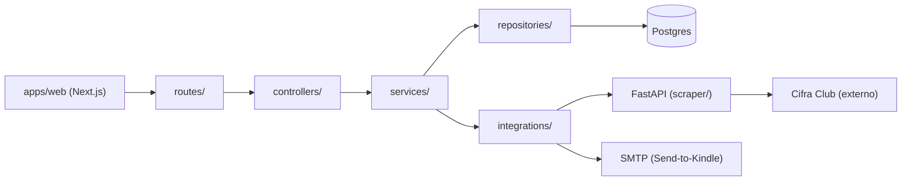
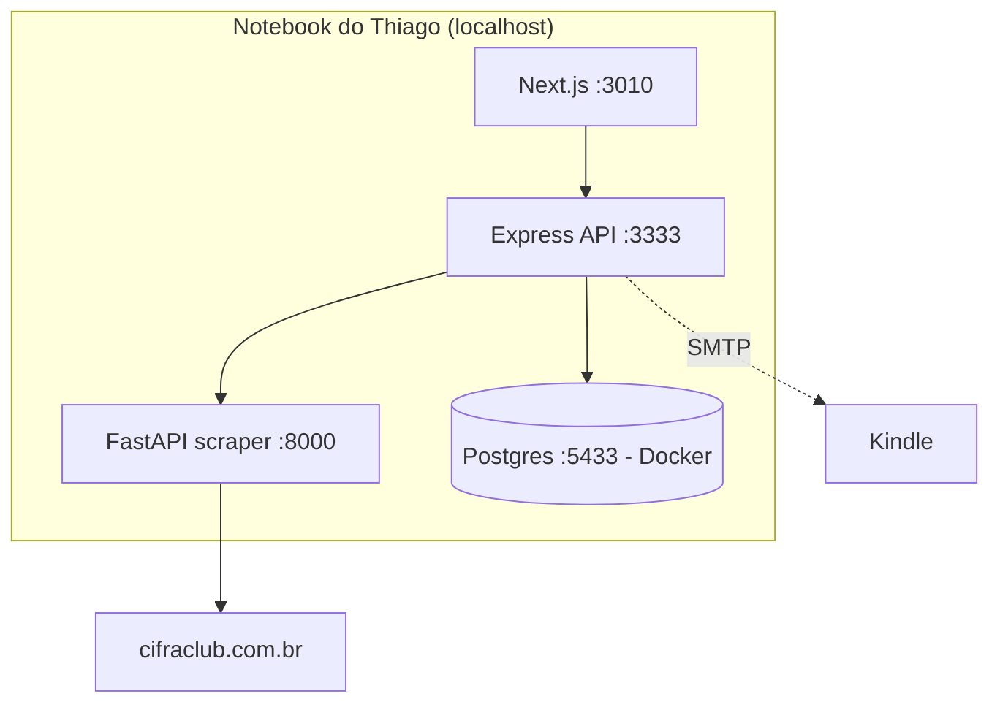
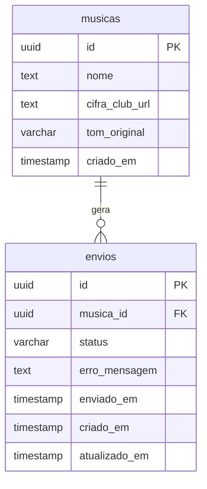

# Diagramas de Arquitetura — Adaptador de Cifras para Kindle

## Pipeline em camadas

## Topologia de ambiente (dev local)

## Modelo de dados

`musicas` guarda o que foi buscado (deduplicado pela URL do Cifra Club); `envios` guarda cada execução do pipeline — alimenta o histórico e o progresso na UI (ver Constraints C-9/C-10 e `api-contracts.md`).
